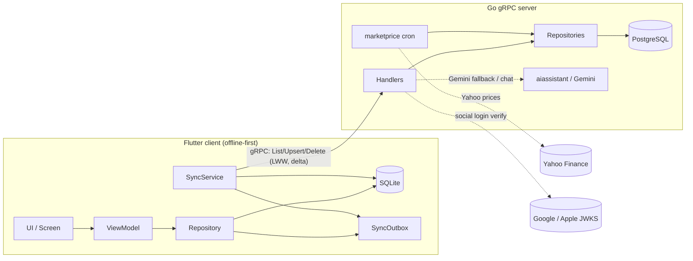

# Architecture

## Purpose

Pocket Pilot is an **offline-first personal finance app**. The Flutter client writes
everything to local SQLite first and stays fully usable offline; a background sync process
reconciles with a Go/gRPC backend backed by PostgreSQL, using **Last Write Wins (LWW)** for
conflict resolution and **delta pull** for efficient catch-up. Protobuf contracts in `proto/`
are the shared source of truth for both sides.

## Code layout

```
pocket-pilot/
├── proto/pocket_pilot/v1/     # gRPC contracts (source of truth) — one *_service.proto per entity + common.proto
├── backend/                   # Go gRPC server + PostgreSQL
│   ├── cmd/server/            # entrypoint (main)
│   ├── migrations/            # numbered PostgreSQL migrations (001..018)
│   └── internal/
│       ├── <entity>/          # one package per domain: handler.go (gRPC) + repository.go (pgx SQL)
│       ├── sync/              # SyncService: GetSyncStatus preflight + per-user cursors
│       ├── aiassistant/       # Gemini provider + shared RateLimiter (chat, notification_parser)
│       ├── marketprice/       # investments price cron (Yahoo)
│       ├── notificationparser/, cardmapping/, txrule/, bankpackage/, bankalias/, parserfeedback/  # notification-capture support
│       ├── auth/, jwks/       # custom auth, social login, JWT + JWKS validation
│       ├── middleware/        # gRPC interceptors (auth, logging, errors)
│       ├── database/          # pgxpool connection
│       ├── config/            # env config
│       └── gen/               # GENERATED proto code — do not edit by hand
├── frontend/                  # Flutter app + SQLite
│   ├── lib/src/
│   │   ├── features/<feature>/{domain,data,ui}/   # see "Frontend feature structure"
│   │   ├── core/{db,ids,sync,grpc,auth,notifications,theme,constants}/
│   │   ├── generated/         # GENERATED Dart gRPC stubs — do not edit by hand
│   │   └── ui/                # shared widgets/theme
│   └── assets/migrations/     # numbered SQLite migrations (001..016)
├── scripts/                   # Python bank-statement parsers (uv) + gen_proto.sh + adb dump helper
├── statements/                # sample bank statements (input for the parsers)
├── docker-compose.yml         # local PostgreSQL
└── Makefile                   # up/down/migrate/proto/tidy/run/build
```

## Backend patterns (Go)

- **Repository pattern** — each `internal/<entity>` has a `Repository` owning all SQL via
  `pgxpool`: `GetByID`, `List` (delta pull with `updated_since`), `Upsert` (LWW), `SoftDelete`.
  Row→struct mapping lives in `scan` helpers.
- **Handler pattern** — `Handler` implements the generated gRPC service: validation, auth-context
  extraction, proto↔domain conversion (`toProto`/`fromProto` as private helpers), then calls the
  repository. See [conventions.md](conventions.md).
- **LWW** — every syncable table has `id`, `user_id`, `created_at`, `updated_at`, `deleted_at`;
  updates use `ON CONFLICT (id) DO UPDATE SET … WHERE table.updated_at < EXCLUDED.updated_at`.

## Frontend patterns (Flutter)

- **Feature folders** — `lib/src/features/<feature>/` splits into `domain/` (plain models +
  `fromProto/toProto/toMap/fromMap`), `data/` (`*_local_store.dart` SQL, `*_remote_service.dart`
  gRPC wrapper, `*_repository.dart` local write + outbox, `*_sync_handler.dart`), and `ui/`
  (`*_view_model.dart` `ChangeNotifier` + `*_screen.dart`).
- **Offline-first + Outbox** — all local writes go through a repository and are enqueued in
  `SyncOutbox`; the app never blocks on the network.
- **State & DI** — `Provider`/`ChangeNotifier`; each feature wires its graph in a
  `*_route_scope.dart` (`ChangeNotifierProvider` for list/detail, `*_form_route_scope.dart` with
  `Provider.value` for cross-feature form data). App-wide controllers (e.g. theme) live at `main.dart`.

## Sync (cross-cutting)

Writes: `UI → ViewModel → Repository → SQLite + SyncOutbox`. Each cycle **pulls** (handlers sorted
by `syncOrder`, delta via cursors) then **pushes** (flush outbox respecting FK order). Conflicts
resolved server-side by `updated_at`; if the server wins, the client saves the returned version.
A preflight `GetSyncStatus` + per-user cursor table skips untouched entities (9 RPCs → 1 on cold
sync). Triggers: connectivity recovery, app resume (30s throttle), manual. Full detail:
[features/sync-protocol.md](features/sync-protocol.md) and [decisions/_index.md](decisions/_index.md).

## Entities and data model

- **Contract shape** (`proto/pocket_pilot/v1/`): each syncable entity exposes
  `List/Upsert/Delete<Entity>` RPCs; `List` carries `updated_since`; `Delete` carries `deleted_at`
  for LWW soft deletes. `Money` in `common.proto`; money stored as cents (`BIGINT`/`INTEGER`).
- **PostgreSQL** (`backend/migrations/`, 18 applied): UUID ids, `TIMESTAMP WITH TIME ZONE`, LWW
  columns on syncable tables; composite-key entities (e.g. `user_preferences`) do LWW against their
  unique key.
- **SQLite** (`frontend/assets/migrations/`, 16 applied): `TEXT` UUIDs, ISO-8601 UTC timestamps,
  `INTEGER` cents; may omit `user_id` (single-user local DB). Bump `_version` in `DatabaseHelper`.
- **user_preferences** — cross-cutting key-value store (`pref_key`,`pref_value`) synced like any
  other entity; feeds currency options and `app.theme_mode`.
- **Transfers** — modeled as two linked `transactions` rows (`transfer_out`+`transfer_in` via
  `linked_transaction_id`), reusing the whole transaction sync path (no separate table).

## Internal data flow



## Key libraries

- **Backend** — `google.golang.org/grpc` (transport), `jackc/pgx/v5` (PostgreSQL pool),
  `google/uuid`, `golang-jwt/jwt/v5` (HS256 access tokens + validation).
- **Frontend** — `grpc` (Dart), `sqflite` (local DB), `provider` (state), `connectivity_plus`
  (sync triggers), `fixnum` (int64 from gRPC), `google_sign_in` / `sign_in_with_apple` (social
  login), `flutter_secure_storage` (tokens), `fl_chart` (stats/cashflow), `csv` (import).
- **Scripts** — `pdfplumber` (PDF extraction), `uv` (Python project mgmt).

## Critical notes for collaborators

- **Never hand-edit generated code** (`backend/internal/gen/`, `frontend/lib/src/generated/`).
  After any `.proto` change run `make proto` (`./scripts/gen_proto.sh`).
- **MVP schema exception** — while no production data exists it is acceptable to edit the baseline
  `001_*.sql` migrations directly to add required columns, rather than always appending a migration.
- **Deterministic generators** — scheduled transactions, interest and investment transactions use
  fixed **UUIDv5 namespaces** (`core/ids/`) so re-runs are idempotent. Don't change a namespace.
- **Notification capture gotchas** — the Android NLS survives `am force-stop` and keeps a SQLite
  file handle (pushing a modified DB to the device fails); `showModalBottomSheet` does **not**
  inherit providers, so re-provide via `MultiProvider(.value)`. See
  [features/notification-capture.md](features/notification-capture.md).
- **Category icons/colors** are stored as codepoint-hex / hex-without-`#` and must be rendered via
  the helpers, never as raw `Text`. See [conventions.md](conventions.md).
- **Documentation gap** — the frontend `features/debts/` module has no feature doc yet; document it
  before extending. `categories`, `tags` and `user_preferences` are covered here and in
  [conventions.md](conventions.md) rather than in dedicated feature docs.
- Historical planning artifacts live in `plans/` and `docs/specs/` (previous "superpowers"
  workflow); they are reference-only and may lag the current code.
```
