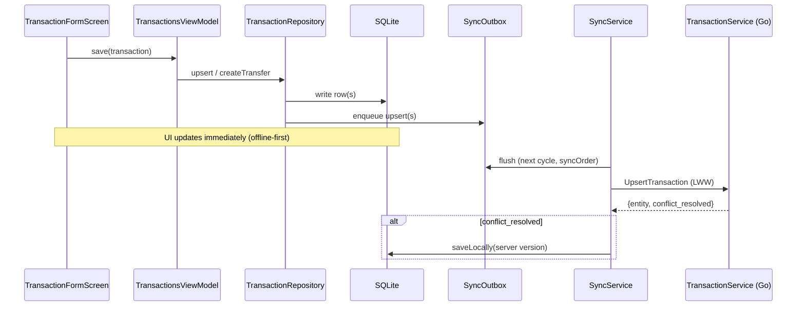

# Transactions & Transfers

## What it does

The core ledger: income/expense entries and account-to-account transfers, with tags, notes,
multi-currency, filtering, and offline-first sync. Transactions are the substrate other features
build on (templates, yields, investments, budgets, statistics all produce or read `transactions`).

## Entry points

Flutter feature module `features/transactions/`. Screens (routes outside `ShellRoute` except the
list, which lives in the shell):

| Route | Screen | Notes |
| ----- | ------ | ----- |
| `/transactions` | `TransactionsScreen` | 4-tab scaffold (Transacciones, Plantillas, Rendimientos, Deudas); tab 1 is the list + persistent filter sheet + "Por confirmar" section; the other tabs mount the feature-local `TransactionTemplatesListBody`, `YieldConfigsListBody`, `DebtsListTab` (view models provided by `TransactionsRouteScope`) |
| `/transactions/new` (income/expense) | `TransactionFormScreen` | numpad in calculator mode |
| transfer form | `TransferFormScreen` | DESDE/HACIA cards, FX rate |

Backend: `internal/transaction` (`TransactionService` — List/Upsert/Delete). Contract:
`proto/pocket_pilot/v1/transaction_service.proto`.

## Files involved

- `features/transactions/domain/` — `TransactionModel` (`tags`, optional `templateId`, nullable
  `categoryId`, `source` provenance since frictionless-capture f3), `transaction_filter.dart`
  (`TransactionFilter` value object).
- `features/transactions/data/` — `transaction_local_store.dart` (SQL incl. `queryRowsFiltered`,
  `queryTopCategoryIds` — optionally scoped by `accountId` since frictionless-capture f2 — and
  `hasAmbiguousCategoryHistoryForDescriptionPrefix` since f3, consumed by notification-capture's
  auto-confirm ambiguity check), `transaction_repository.dart` (`createTransfer`,
  `softDelete(id, linkedId)`, `getTopCategoryIdsForAccount(accountId, {limit})` — consumed
  cross-feature by notification-capture's quick-pick category chips), sync handler + remote
  service (`transactionFromPayload` builds the outbound proto — every model field, incl. `source`,
  must be forwarded there).
- `features/transactions/ui/` — `transactions_view_model.dart`, `transaction_filter_view_model.dart`,
  `transactions_screen.dart`, plus the form screens documented in
  [transaction-forms.md](transaction-forms.md).
- Backend `internal/transaction/{handler.go,repository.go}`.

## Data flow

## Key behaviors

### Transfers (paired transactions)

A transfer is **two** `transactions` rows — `transfer_out` + `transfer_in` — linked by
`linked_transaction_id` (no separate table). `createTransfer()` generates two UUIDs, writes both to
SQLite, and enqueues both independently; each leg syncs via the normal `UpsertTransaction` RPC.
Cascade delete uses a SQLite batch (`softDelete(id, linkedId:)`) enqueuing two outbox entries; the
backend `SoftDelete` also cascades inside a PostgreSQL transaction (defense in depth). `categoryId`
is `null` for transfers; forms/tiles check `isTransfer` to skip category UI. Same tags propagate to
both legs. FX: matching currencies mirror the amount; differing currencies use MONTO or RATE mode.

### Filters

`TransactionFilter` (immutable: `dateFrom`/`dateTo` YYYY-MM-DD, `accountId`, `categoryIds`, `type`,
`status`, `currencyCode`; `defaultFilter()` = last 30 days; `typeValues` expands `"transfer"` →
`['transfer_out','transfer_in']`). `TransactionFilterViewModel` (implements `TemporalFilterState`;
the `QuickRange`/`PeriodGranularity` enums now live in `ui/widgets/temporal_page_view.dart`) drives
the persistent `DraggableScrollableSheet`, whose temporal picker is the shared `TemporalPageView`
(Quick 7D/30D/6M/1Y, Period Semana/Mes/Año with ←/→ — labels converged EN→ES in widget-unification
phase 4 — Custom dates; expanded: account/type/status/currency + top-5 category chips +
`CategoryMultiPicker`).
`TransactionsViewModel` listens and re-queries on every change (listener removed in `dispose()`).
`queryRowsFiltered` builds a dynamic `WHERE`; empty state is filter-aware.

### "Por confirmar" section

The top of `/transactions` unifies pending suggestions from two sources: `PendingTransactionModel`
(notification capture) and `TransactionModel.status='pending'` (template occurrences), each with a
`Dismissible` + confirm dialog. Confirming a transfer confirms both legs. See
[notification-capture.md](notification-capture.md) and [transaction-templates.md](transaction-templates.md).

### Provenance (`source` column, frictionless-capture f3)

`transactions.source` records how a transaction was created: `'manual'` (default — forms, voice,
human-approved suggestions), `'auto_notification'` (auto-confirmed by the notification-capture
gate; rendered as an "Auto" badge in `_TransactionTile`), and `'import_csv'` (stamped by the CSV
importer's `importBatch()` — see [csv-import.md](csv-import.md)). Synced end-to-end: proto field 21, PG mig 020 /
SQLite mig 018 (`TEXT NOT NULL DEFAULT 'manual'`). `createTransaction` defaults it to `'manual'`;
`confirmTransaction` and `updateTransaction` preserve the existing value. See
[decisions/0004-transaction-source-provenance.md](../decisions/0004-transaction-source-provenance.md).

### Categories & seeder

Categories are a foundational entity (`features/categories/`, `internal/category`).
`CategorySeeder.seedIfNeeded()` runs in `main()` before `runApp()` (skips if
`app_metadata['categories_seeded']` exists): reads `assets/categories/defaults.json`, recursively
flattens the tree, generates UUIDs/timestamps (children inherit `type`/`color`), resolves icon names
to hex via `CategoryIconData.resolveIcon()`, then enqueues all to `SyncOutbox`.

## Edge cases

- A transfer leg deleted without its pair leaves an orphan — always delete via `softDelete(id, linkedId:)`.
- Filter `type='transfer'` must expand to both leg types in SQL, or transfers disappear from results.
- Adjustment transactions (`nature='adjustment'`, `categoryId=null`) are transactions too — see
  [adjustment-nature.md](adjustment-nature.md) for the tap-routing guard.
- New model fields must be forwarded in `transaction_remote_service.dart::transactionFromPayload`
  or they silently reset to their backend default on sync — bit both f1 (`pattern_id` on card
  mappings) and f3 (`source`, caught by verify before release); both now have regression tests.
- A client running a pre-`source` app version that edits an auto transaction resets its server
  `source` to `'manual'` under LWW (whole-row wins). Accepted single-user edge; self-healing as
  clients upgrade.

## Related docs

- [transaction-forms.md](transaction-forms.md) — detailed form widget structure.
- [decisions/0001-sync-strategy.md](../decisions/0001-sync-strategy.md) — LWW + delta pull.
